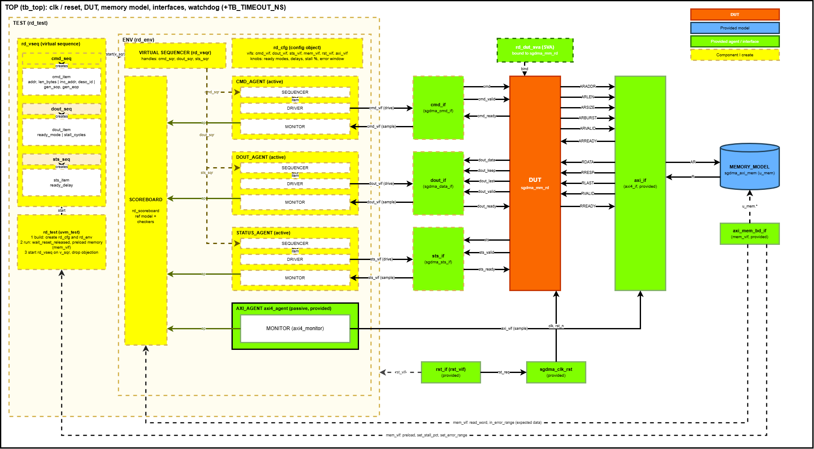
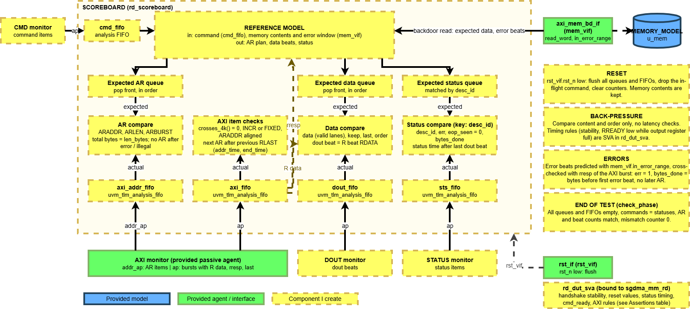

# J3 SGDMA MM Read (`sgdma_mm_rd`) Verification Workspace

This repository contains a UVM-based verification workspace for the **J3 SGDMA Memory-Mapped Read (MM-RD)** engine. It includes the RTL/package, a reusable DV library, harness/testbench integration, channel interfaces and UVM components (items/agents/drivers/monitors), tests, documentation/specs, and a verification test plan.

## Overview

`sgdma_mm_rd` performs memory-mapped reads from an AXI4 memory system and streams read data out through a data-beat channel, with command input and status reporting.

At a high level, the verification environment around the DUT includes:

- **Command channel (`cmd`)**: TB drives command transactions into the DUT.
- **Data-out channel (`dout`)**: DUT produces read data beats; TB receives them (and provides backpressure via `ready`).
- **Status channel (`sts`)**: DUT reports completion/status; TB receives status transactions.
- **AXI4 memory interface**: observed via a passive AXI4 monitor/agent and backed by a memory model/backdoor in the harness environment.
- **Reset/clock and harness integration**: `tb_top` connects DUT, interfaces, and virtual-interface config-db handles for UVM.

## Repository structure

| Path | Description |
| --- | --- |
| `rtl/` | DUT RTL and packages (e.g. `sgdma_mm_rd.sv`, `sgdma_pkg.sv`). |
| `harness/` | Harness/top-level TB integration (`tb_top.sv`, harness package/tests). |
| `dv_lib/` | Reusable verification components (AXI4 agent, AXI4-Lite, AXI memory BFMs/backdoor, interfaces, reset, utilities). |
| `tb_uvm/` | J3-specific UVM environment components (interfaces, sequence items, drivers/monitors/agents, env/scoreboard/coverage/sequences packages). |
| `tests/` | UVM test package and tests (e.g. base/smoke-oriented tests). |
| `sim/` | Simulation filelists/build inputs (e.g. `my_tb.f`, `harness.f`). |
| `docs/` | Specifications and project documentation (HTML), including J3 MM-RD docs/test plan. |
| `testplan/` | Test plan assets and architecture diagrams. |
| `coverage/`, `bug_reports/` | Coverage and bug-tracking artifacts (workspace areas). |

## Verification architecture

### UVM environment

### Scoreboard / checking intent

## Key `tb_uvm` components

- **Interfaces** (`sgdma_cmd_if.sv`, `sgdma_data_if.sv`, `sgdma_sts_if.sv`): channel signal bundles/clocking for cmd, dout, and status.
- **Transactions/items** (`j3_cmd_item.svh`, `j3_dout_item.svh`, `j3_sts_item.svh`): payload-level sequence items for command, data beats, and status (including `sgdma_cmd_t` / `sgdma_sts_t` helpers where applicable).
- **Agents** (`j3_*_agent.svh`): per-channel agents with sequencer/driver/monitor in active mode and monitor in passive mode.
- **Drivers** (`j3_*_driver.svh`): cmd driver performs valid/ready command handshakes; dout/sts drivers provide TB-side `ready` control for DUT-output channels.
- **Monitors** (`j3_*_monitor.svh`): observe `valid && ready` handshakes and publish transaction items via analysis ports.
- **Environment** (`j3_env.svh`, `j3_env_pkg.sv`): integrates J3 channel agents and a passive AXI4 monitor agent (`dv_lib/axi4_agent`) with scoreboard/coverage hooks.

## Documentation and test plan

- J3 MM-RD docs: `docs/j3_mm_rd/` (e.g. `testplan.html`, `tb_connections.html`, coverage/bug report pages)
- Common/spec docs: `docs/specs/` and `docs/index.html`
- Diagram sources/assets: `testplan/diagrams/`

> Note: the HTML test plan uses editable client-side behavior (`docs/assets/js/editable.js`) that may persist section edits in browser `localStorage`, so browser-rendered content can differ from the static file until reset/cleared.

## Getting started

1. Review the specs/docs in `docs/specs/` and `docs/j3_mm_rd/` for DUT behavior and TB connections.
2. Use the provided filelists in `sim/` and the harness in `harness/tb_top.sv` as integration entry points.
3. Build/run with your preferred SystemVerilog/UVM simulator flow (tooling and environment setup are external to this repo).

This is an evolving verification workspace; some components (e.g. scoreboard/checking, coverage closures, sequences/tests) may be partially implemented or under active development.